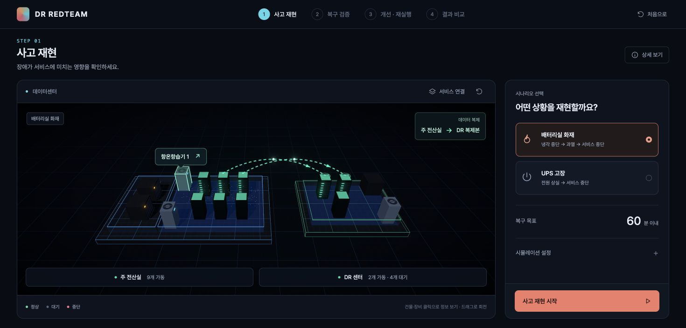
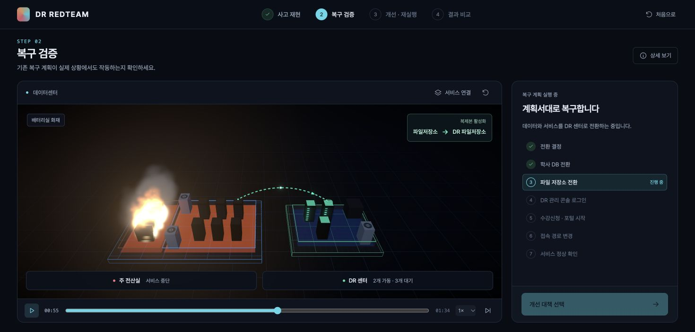

# DR REDTEAM · 재해복구 레드팀 시뮬레이터

**재해복구 계획이 실제 장애 상황에서도 작동하는지 확인하는 3D 프론트엔드 프로토타입입니다.**

주 전산실에 화재나 전원 장애가 발생했을 때, 별도의 DR(Disaster Recovery, 재해복구) 센터에서 서비스를 이어갈 수 있는지 검증합니다. 사고 재현부터 기존 복구 계획의 실패 원인 확인, 예산에 맞는 개선안 적용, 결과 비교까지 클릭으로 경험할 수 있습니다.

현재는 **가상 데이터와 브라우저 안의 모의 실행기**로 동작합니다. 별도 백엔드나 데이터베이스 설치 없이 실행할 수 있습니다.

## 화면 미리 보기

### 3D 데이터센터와 장비 정보

장비 위에 마우스를 올리면 해당 장비만 강조되고 이름이 나타납니다. 건물·장비를 클릭하면 역할, 상태, 연결된 구성을 확인할 수 있습니다.



### 복구 검증과 전환 경로

복구 절차에 따라 민트색 점선과 이동하는 점, 화살표가 현재 출발지와 도착지를 보여줍니다. 연결에 실패하면 붉은 경로로 표시합니다.



## 시연 흐름

| 단계 | 사용자가 하는 일 | 확인할 내용 |
| --- | --- | --- |
| 1. 사고 재현 | 배터리실 화재 또는 UPS 고장을 선택하고 시작 | 전원·냉각 장애가 서버와 서비스 중단으로 이어지는 과정 |
| 2. 복구 검증 | 기존 복구 계획 실행 | DR 관리 콘솔이 중단된 주 전산실 인증 서버에 의존해 로그인에 실패하는 문제 |
| 3. 개선 · 재실행 | 예산 안에서 대책을 선택하고 다시 검증 | 인증 이중화, 동기 복제, 관제 구축, 학사정보 API 배치의 효과 |
| 4. 결과 비교 | 개선 전후 결과 확인 | 복구 시간, 데이터 유실, 기능 저하, 회차별 적용 대책 |

기본 예산 **5억 원**에서 `통합인증 DR 이중화`와 `학사 DB 동기 복제` 두 가지를 선택하면 DR 로그인 문제를 해결하고 모의 DB 유실을 0건으로 만드는 흐름을 확인할 수 있습니다. 이 조합에서도 학사정보 연동 기능 저하는 남으므로 결과 화면에서 별도로 안내합니다.

### 화면 조작

- **마우스 올리기 / 클릭:** 건물·장비·서비스의 이름과 세부 정보 확인
- **드래그 / 휠:** 3D 화면 회전 및 확대·축소
- **서비스 연결:** 서비스 노드와 의존 관계 표시
- **전체 시점으로:** 카메라 위치 초기화
- **재생 막대:** 일시정지, 시점 이동, 재생 속도 변경
- **결과 바로 보기:** 현재 시뮬레이션의 마지막 시점으로 이동
- **상세 보기:** 서비스, 지표, 복구 절차, 분석, 실행 로그 확인
- **결과 비교:** 검증 기록을 JSON으로 저장하거나 인쇄

## 주요 기능

- **사고 시뮬레이션:** 전원·냉각 상태, 실내 온도 변화, 서버 종료 정책에 따른 장애 전파
- **복구 계획 검증:** 서비스 간 필수·보조 의존 관계를 계산하고, 계획서에 없던 의존 관계 발견
- **예산 기반 개선:** 대책별 비용과 예상 효과 확인, 추천 조합 선택, 적용 후 재검증
- **3D 시각화:** 전산실·DR 센터·서버 랙·UPS·냉각 장비, 화재·연기, 단계별 전환 경로
- **결과 비교:** 모의 복구 시간, DB 유실 건수, 남은 기능 저하, 회차별 대책 비교

## 구성과 동작 방식

React 화면과 3D 장면이 같은 시뮬레이션 이벤트를 참조합니다. 재생 위치를 옮기면 해당 시점까지의 이벤트로 상태를 다시 계산하므로, 장비 상태·복구 절차·전환 경로를 함께 되돌려 볼 수 있습니다.

1. `src/sim/model.ts`의 가상 데이터로 공간·장비·서비스·의존 관계·복제 설정을 구성합니다.
2. 사고 엔진이 전원·냉각 장애와 온도 변화에 따른 이벤트를 생성합니다.
3. 복구 실행기는 절차별 선행 조건과 서비스 가용성을 검사합니다.
4. 개선안을 적용하면 구성을 변경하고 복구 검증을 다시 실행합니다.
5. Zustand가 이벤트와 재생 상태를 관리하고 React / Three.js가 결과를 표시합니다.

### 기술 스택

| 구분 | 기술 |
| --- | --- |
| 화면 | React 18, TypeScript |
| 개발·빌드 | Vite 5 |
| 3D | Three.js, React Three Fiber, Drei, React Three Postprocessing |
| 상태 관리 | Zustand |
| 테스트 | Vitest |
| 스타일 | CSS, Pretendard |

### 프로젝트 구조

```text
src/
├── scene/             # 3D 공간·장비, 마우스 강조, 서비스·전환 경로
├── sim/
│   ├── model.ts       # 가상 토폴로지, 복구 절차, 개선 대책
│   ├── incident.ts    # 사고·온도·서버 종료 시뮬레이션
│   ├── graph.ts       # 의존 관계에 따른 가용성 계산
│   ├── rehearsal.ts   # 복구 절차 모의 실행
│   ├── analysis.ts    # 문서 기준 정적 분석
│   ├── budget.ts      # 예산 기반 대책 추천
│   ├── events.ts      # 시뮬레이션 이벤트 정의
│   └── world.ts       # 이벤트를 현재 화면 상태로 변환
├── ui/                # 시연 단계, 상세 정보, 대책 선택, 결과 비교
├── store.ts           # 시뮬레이션·재생 상태 관리
├── styles.css         # 화면 스타일 및 반응형 구성
└── main.tsx           # 애플리케이션 진입점
public/fonts/          # 화면에 사용하는 폰트
docs/images/          # README 화면 캡처
```

## 프로토타입 범위

- 모든 기관 정보, 장비 구성, 예산, 부하, 복제 지연은 시연용 가상 값입니다.
- 복구 성공·실패는 설정된 서비스 의존 관계로 계산합니다. 실제 서버나 컨테이너를 중지·기동하거나 데이터를 복제하지는 않습니다.
- 자동 복구 단계의 소요 시간은 모의 값이며, 사람의 대응 시간은 화면에 입력한 예상 값입니다. 재생 막대의 시간은 시연 타임라인이므로 결과의 복구 시간과 다릅니다.
- 유실 건수는 쓰기 부하와 학사 DB 복제 지연으로 계산한 모의 결과입니다. `0건`은 이 모델의 DB 유실을 의미합니다.
- DB·파일 복구 경로는 DR에 이미 준비된 복제본을 활성화하는 운영 전환을 나타냅니다.
- 향후 실제 실행기를 연결할 때는 `SimEvent` 형식의 이벤트를 받아 `store.ts`의 모의 실행 호출을 교체하는 방식으로 확장할 수 있습니다.

## 실행 방법

### 준비

- Node.js 22 이상, npm
- Git
- WebGL을 지원하는 브라우저

공개 저장소이므로 GitHub 로그인 없이 코드를 내려받을 수 있습니다.

### 설치 및 개발 서버 실행

```bash
git clone https://github.com/LabGuard/dr-redteam-sim.git
cd dr-redteam-sim
npm ci
npm run dev
```

브라우저에서 **http://127.0.0.1:5180/** 을 엽니다. 포트가 사용 중이면 터미널에 표시된 Local 주소를 확인하세요. 서버를 종료할 때는 터미널에서 `Ctrl+C`를 누릅니다.

### 테스트 및 빌드

```bash
npm test             # 시뮬레이션, 화면 상태, 전환 경로 테스트
npm run typecheck    # TypeScript 검사
npm run build        # 배포용 파일 생성 → dist/
```

### 빌드 결과 미리 보기

```bash
npx vite preview --host 127.0.0.1 --port 4173
```

브라우저에서 **http://127.0.0.1:4173/** 을 엽니다.
